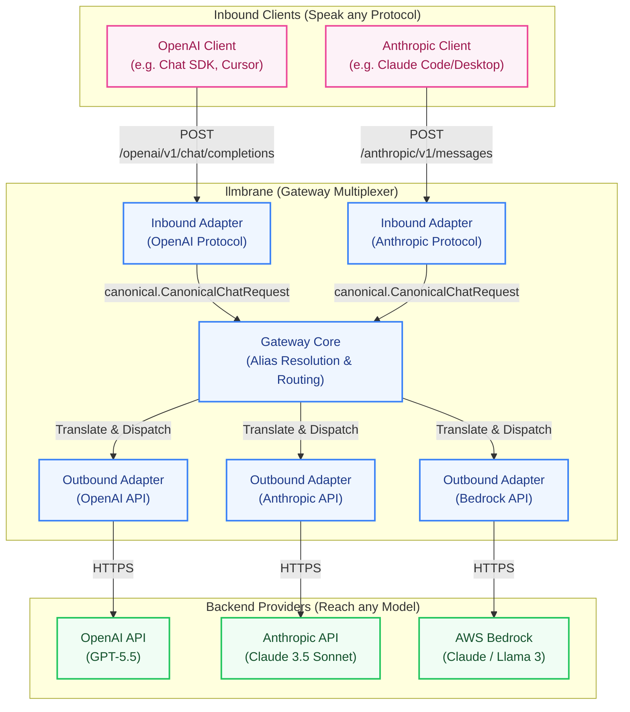

# llmbrane

`llmbrane` is a lightweight gateway for routing LLM requests across multiple providers through a single, configurable interface.



Today, `llmbrane` exposes OpenAI-compatible and Anthropic-compatible inbound APIs. Clients can send normal OpenAI-style or Anthropic-style requests to the gateway, while `llmbrane` resolves model aliases, selects the configured backend provider, translates the request into that provider's API shape, and translates the response back for the client.

The architecture is designed to support multiple inbound APIs over time. That means clients can speak different familiar API formats, such as OpenAI, Anthropic, or other protocol shapes, while still reaching any configured outbound provider behind the gateway.

Use it when you want to:

- switch models or providers without changing client code
- expose one stable API to tools that only understand OpenAI-style requests
- route requests to cloud, local, or self-hosted models from configuration
- keep provider credentials and model mappings centralized
- add new providers or inbound API formats behind a consistent gateway architecture

## Getting Started

### 1. Create your Configuration

`llmbrane` uses a simple configuration file and environment variables for secrets. You can deploy and run it with just two files.

First, create a `config.yaml`:

```yaml
# yaml-language-server: $schema=https://raw.githubusercontent.com/mayer-tech/llmbrane/main/config.schema.json
version: 1
server:
  listen: ":8080"
  request_timeout: 120s

aliases:
  gpt-latest: openai/gpt-5.6-sol
  claude-sonnet: anthropic/claude-sonnet-4-6
  opus: anthropic/claude-opus-5-5

providers:
  openai:
    endpoints:
      - api: "openai-responses"
        url: "https://api.openai.com/v1/responses"
        headers:
          Authorization: "Bearer ${OPENAI_API_KEY}"
        # Optional: enables a local in-memory TPM queue for this endpoint.
        rate_limit:
          tokens_per_minute: 200000
          utilization: 0.9
          queue_timeout: 30s
          # Internal reservation only; not sent to the model.
          output_reservation_tokens: 8192
        extensions:
          omit_params: ["temperature", "top_p"]
        models:
          gpt-5.6-sol:
            target: gpt-5.6-sol
          gpt-5.6-terra:
            target: gpt-5.6-terra
          gpt-5.6-luna:
            target: gpt-5.6-luna

  anthropic:
    endpoints:
      - api: "anthropic-messages"
        url: "https://api.anthropic.com/v1/messages"
        headers:
          x-api-key: "${ANTHROPIC_API_KEY}"
        models:
          claude-sonnet-4-6:
            target: claude-sonnet-4-6
      # Separate endpoint: these models do not support custom sampling values.
      - api: "anthropic-messages"
        url: "https://api.anthropic.com/v1/messages"
        headers:
          x-api-key: "${ANTHROPIC_API_KEY}"
        extensions:
          omit_params: ["temperature", "top_p"]
        models:
          claude-opus-4-8:
            target: claude-opus-4-8
            default_reasoning_effort: medium
          claude-opus-5-5:
            target: claude-opus-5-5
            default_reasoning_effort: medium

  gemini:
    endpoints:
      - api: "openai-chat-completions"
        url: "https://generativelanguage.googleapis.com/v1beta/openai/chat/completions"
        headers:
          Authorization: "Bearer ${GEMINI_API_KEY}"
        extensions:
          inject_thought_signature_bypass: true
          reasoning_effort_mapping:
            none: "low"
            minimal: "low"
            xhigh: "high"
            max: "high"
        models:
          gemini-pro-latest:
            target: gemini-pro-latest
          gemini-flash-latest:
            target: gemini-flash-latest
          gemini-flash-lite-latest:
            target: gemini-flash-lite-latest
```

Next, create a `.env` file containing your API keys:

```env
OPENAI_API_KEY=your-openai-api-key-here
ANTHROPIC_API_KEY=your-anthropic-api-key-here
```

*(For a more comprehensive example configuration including AWS Bedrock or Google Gemini, see the [config.example.yaml](config.example.yaml) in the repository.)*

### 2. Run the Container

Start the gateway using Docker Compose. Create a `docker-compose.yml` file pointing to the official `llmbrane` image:

```yaml
services:
  llmbrane:
    image: ghcr.io/mayer-tech/llmbrane:latest
    ports:
      - "8080:8080"
    volumes:
      - ./config.yaml:/config/config.yaml:ro
    env_file:
      - .env
    restart: unless-stopped
```

Then run:

```bash
docker compose up -d
```

### 3. Example Requests

Since `llmbrane` provides an OpenAI-compatible and Anthropic-compatible inbound handler, you can interact with it using standard API structures. Use either model aliases from `config.yaml` or explicit names in the `provider/model` format.

**Requesting via OpenAI API shape (using the alias `gpt-latest`):**
```bash
curl http://localhost:8080/openai/v1/chat/completions \
  -H "Content-Type: application/json" \
  -d '{
    "model": "gpt-latest",
    "messages": [{"role": "user", "content": "Hello, how are you?"}]
  }'
```

**Requesting via OpenAI Responses API (using a Responses-backed alias):**
```bash
curl http://localhost:8080/openai/v1/responses \
  -H "Content-Type: application/json" \
  -d '{"model":"gpt-latest","input":"Hello!"}'
```

See [OpenAI Responses inbound](#openai-responses-inbound) for stateless continuation and streaming requirements.

**Requesting via Anthropic API shape (using the alias `claude-sonnet`):**
```bash
curl http://localhost:8080/anthropic/v1/messages \
  -H "Content-Type: application/json" \
  -H "x-api-key: none" \
  -d '{
    "model": "claude-sonnet",
    "max_tokens": 1024,
    "messages": [{"role": "user", "content": "Hello, Claude!"}]
  }'
```

## OpenAI Responses inbound

`POST /openai/v1/responses` accepts a model alias or `provider/model` routed to an `openai-responses` endpoint. The request goes through the normal gateway policies, model defaults, rate limits, retries and cancellation. Cross-API routes are rejected, not approximated.

The supported stateless input is a string or an ordered array of message, reasoning, function call and string function call output items. Message content supports text, image URLs, and output refusals. Function tools, tool choice, instructions, sampling, maximum output tokens, reasoning settings, text formatting, metadata, truncation and parallel tool calls are forwarded. Other top-level request fields, built-in tools, item references, audio/file content and other item types are rejected; unsupported provider output item types and content also cause an error. Provider-specific extra fields on supported items are preserved. The backend remains responsible for validating its native fields and model support. Endpoint `omit_params` and `reasoning_effort_mapping` apply as usual.

The gateway sends `store: false` and automatically includes `reasoning.encrypted_content`. Clients must retain the **complete output items** in order, including reasoning IDs, summaries, encrypted content, messages, function calls and any additional fields, and send those items back in `input` along with the prior history, function outputs and new messages on every continuation. Do not reconstruct items from text deltas or use `previous_response_id`; server-side conversation storage is not supported. In streaming mode retain the complete items from `response.output_item.done` or the terminal response's `output`, not just deltas. SSE event JSON and provider metadata are passed through (SSE comments and transport fields such as `id` and `retry` are not); events are limited to 10 MiB. `response.failed`, `error` and truncated streams do not produce a synthetic successful completion. `response.incomplete` is forwarded as a distinct terminal event.

Encrypted reasoning is opaque and can be replayed only where the backend/model supports it; it is not portable across providers or necessarily across models. If a compatible backend rejects the include field, set endpoint extension `disable_encrypted_reasoning: true` to disable automatic inclusion. This cannot provide encrypted reasoning continuity; an explicit client include is still forwarded. Native items and encrypted content may contain sensitive data and may appear in enabled debug logs. No Chat Completions reasoning-details or Anthropic cross-API envelope is provided by this endpoint.

## Configuration

`config.yaml` defines how the gateway listens, how incoming model names are resolved, and which provider APIs are called.

- `server.listen` controls the bind address. The example uses `:8080`.
- `server.request_timeout` sets the request timeout value stored in configuration.
- `retry` (optional) configures provider-side HTTP 429 retries: `max_retries` (default `6`, `0` disables retries), `base_delay` (default `1s`), `jitter` (default `250ms`), and `max_delay` (default `60s`). See [Rate-Limit Handling](#rate-limit-handling).
- `aliases` maps convenient client-facing model names to explicit `provider/model` targets. For example, `gpt-latest: openai/gpt-5.5` lets clients send `"model": "gpt-latest"`. An alias can also be a mapping with a `target` and an optional `default_reasoning_effort` override (see [Reasoning Effort Support](#reasoning-effort-support)).
- `providers` contains named backend providers. The provider name becomes the first part of an explicit model reference, such as `anthropic/claude-sonnet-4-6`.
- `providers.<name>.endpoints[].api` selects the outbound adapter/API shape.
- `providers.<name>.endpoints[].url` is the provider endpoint. Bedrock URLs can include `{target_model}`, which is replaced with the configured target model.
- `providers.<name>.endpoints[].headers` configures provider-specific HTTP headers. Values like `${OPENAI_API_KEY}` are read from the process environment.
- `providers.<name>.endpoints[].models` maps llmbrane model names to provider-native `target` model IDs.
- `providers.<name>.endpoints[].models.<name>.default_reasoning_effort` sets a canonical reasoning effort (`none`, `minimal`, `low`, `medium`, `high`, `xhigh`, `max`) applied when the client omits `reasoning_effort`. See [Reasoning Effort Support](#reasoning-effort-support).
- `providers.<name>.endpoints[].models.<name>.default_max_output_tokens` sets a positive output limit when the client omits one. See [Output Token Limits](#output-token-limits).
- `providers.<name>.endpoints[].extensions` enables adapter-specific behavior.

Local secrets are intentionally kept out of the repository and Docker build context. The examples contain placeholders only; real credentials belong in your untracked `.env` file or in the process environment.

### Browser access (CORS)

Browser clients can call both APIs cross-origin, including streaming responses. By default, CORS allows all origins, `GET`, `HEAD`, and `POST`, and the headers requested by the browser (including `Authorization` and `x-api-key`). Cookies and other browser-managed credentials are not supported. `Retry-After` is exposed to browser JavaScript.

To restrict browser access, configure exact origins, including scheme and port:

```yaml
server:
  cors:
    allowed_origins: ["https://app.example.com", "http://localhost:3000"]
```

Omit `allowed_origins` or use `["*"]` to allow all origins; use `[]` to disable cross-origin access. CORS is not authentication: non-browser clients can still call the gateway, and an open gateway can consume configured provider resources. Restrict network access or add authentication at a reverse proxy when needed.

### JSON Schema & Editor Support

The repository ships a JSON Schema for `config.yaml`: [config.schema.json](https://github.com/mayer-tech/llmbrane/blob/main/config.schema.json) ([raw](https://raw.githubusercontent.com/mayer-tech/llmbrane/main/config.schema.json)). It validates the full configuration structure, including the `api` enum, capability names, `rate_limit` ranges, and adapter-specific `extensions` keys.

Add the schema reference as the first line of your `config.yaml` to get validation, autocompletion, and hover documentation in editors that support the YAML language server (VS Code with the [YAML extension](https://marketplace.visualstudio.com/items?itemName=redhat.vscode-yaml), Neovim, etc.):

```yaml
# yaml-language-server: $schema=https://raw.githubusercontent.com/mayer-tech/llmbrane/main/config.schema.json
version: 1
```

Alternatively, map the schema once in your editor settings instead of the comment, e.g. in VS Code's `settings.json`:

```json
{
  "yaml.schemas": {
    "https://raw.githubusercontent.com/mayer-tech/llmbrane/main/config.schema.json": "config.yaml"
  }
}
```

When working inside a clone of this repository, a relative reference also works: `# yaml-language-server: $schema=./config.schema.json`.

### Available Outbound Adapters

`llmbrane` currently supports the following outbound API shapes, configured via the `api` field in an endpoint:

- **`openai-chat-completions`**: Standard OpenAI API (`/v1/chat/completions`). Used for OpenAI and OpenAI-compatible endpoints like local servers or Google Gemini's OpenAI compatibility mode.
  - **Configuration**: Requires standard OpenAI headers, such as `Authorization: Bearer ...`.
  - **Extensions**: 
    - `inject_thought_signature_bypass` (boolean): Injects a `skip_thought_signature_validator` bypass for tool calls.
    - `reasoning_effort_mapping` (map): Custom mapping table for `reasoning_effort` values (e.g. mapping `xhigh` or `max` to `high` for models that only accept `low`, `medium`, `high`).
- **`openai-responses`**: OpenAI Responses API (`/v1/responses`). Supports text, image, tool calls, reasoning summaries, and structured output (`json_schema`, `json_object`).
  - **Configuration**: Requires standard OpenAI headers, such as `Authorization: Bearer ...`.
  - **Extensions**:
    - `reasoning_effort_mapping` (map): Custom mapping table for `reasoning_effort` values.
    - `omit_params` (list of strings): Parameters that must not be sent to the provider (e.g. `temperature`, `top_p` for reasoning models that reject them).
- **`anthropic-messages`**: Anthropic's Messages API.
  - **Configuration**: Requires Anthropic-specific headers, such as `x-api-key`. By default, active reasoning levels use adaptive thinking and `output_config.effort`; `none` requests disabled thinking.
  - **Extensions**:
    - `thinking_mode`: `adaptive` (default) or `budget` for older models that require manual thinking budgets.
    - `reasoning_effort_mapping`: Maps canonical levels to other canonical levels before translation, for example `xhigh: high` or `none: low`. Use separate endpoints when models need different settings.
    - `omit_params` (list of `temperature`, `top_p`): Explicitly drops these client-supplied sampling parameters for every model on this endpoint. Use a separate endpoint for models that should retain them. Without this setting, values are forwarded unchanged.
- **`bedrock-converse`**: AWS Bedrock Converse API.
  - **Configuration**: Requires AWS credentials through `extensions` for direct Bedrock calls, or normal HTTP headers when targeting a Bedrock-compatible proxy. Translates canonical `reasoning_effort` into Bedrock Converse thinking parameters under `additionalModelRequestFields`.

### Reasoning Effort Support

`llmbrane` standardizes reasoning effort control across providers into a unified canonical scale:
`none`, `minimal`, `low`, `medium`, `high`, `xhigh`, `max`.

- **OpenAI Inbound**: Accepts `reasoning_effort` strings and passes canonical values through.
- **Anthropic Inbound**: Reads `output_config.effort` (`low`, `medium`, `high`, `xhigh`, `max`) directly. `thinking.type: disabled` maps to `none`. Adaptive thinking without an explicit effort leaves it unset, so alias or model defaults may still apply. For legacy `thinking.type: enabled`, the budget is mapped to a canonical level; the exact budget is lost:
  - `0` / `disabled` $\rightarrow$ `none`
  - `1..1024` $\rightarrow$ `minimal`
  - `1025..2048` $\rightarrow$ `low`
  - `2049..4096` $\rightarrow$ `medium`
  - `4097..8192` $\rightarrow$ `high`
  - `8193..16384` $\rightarrow$ `xhigh`
  - `> 16384` $\rightarrow$ `max`

  The canonical model cannot represent an independent thinking mode and effort. Requests combining `enabled` or `disabled` thinking with an explicit effort, or combining a budget with a different thinking mode, are rejected with HTTP 400.
- **OpenAI Outbound**: Uses canonical `reasoning_effort` values or maps them according to endpoint `reasoning_effort_mapping` extension if configured.
- **Anthropic Outbound**: By default, `none` sends `thinking.type: disabled`; other levels send `thinking.type: adaptive` and `output_config.effort`. `minimal` maps to `low`, while `low`, `medium`, `high`, `xhigh` and `max` pass through. If effort is unset, neither field is sent.
- **Bedrock Outbound**: Translates canonical effort levels to token budgets for AWS Bedrock Converse, as before.

Anthropic endpoint extensions can override the canonical effort before translation or select the legacy budget mode:

```yaml
extensions:
  thinking_mode: budget # optional; default is adaptive
  reasoning_effort_mapping:
    xhigh: high
    # none: low # optional approximation: enables thinking instead of disabling it
```

The mapping applies to every model on the endpoint, including in budget mode. Use separate endpoints for models requiring different modes or mappings. This changes the previous default: older models that require manual budgets must explicitly use `thinking_mode: budget`. Adaptive effort controls the entire response and is not equivalent to a fixed thinking-token budget. Supported effort levels and the ability to disable thinking vary by model; llmbrane does not detect these capabilities, and the provider may reject unsupported combinations. An inbound effort without a thinking mode is also translated to adaptive thinking on Anthropic outbound, so the original mode is not preserved.

For Claude Opus 5.5, configure `omit_params: ["temperature", "top_p"]` as shown in [Getting Started](#1-create-your-configuration), especially when clients such as GitHub Copilot send both fields. This applies to both streaming and non-streaming requests from any inbound protocol. These values are discarded, so the provider default is used instead; `max_tokens` is still required and cannot be omitted. Opus 5.5 also rejects disabled thinking: if a client sends `none`, remove that setting or explicitly map it to another effort with `reasoning_effort_mapping` (for example `none: low`), accepting that this enables thinking. See Anthropic's [Opus 5.5 migration guide](https://platform.claude.com/docs/en/models/opus-5-5/migration-guide) for current restrictions.

Anthropic Messages clients routed to an Anthropic Messages endpoint can round-trip native thinking and redacted thinking blocks, including signatures, in responses, streams, and conversation history. The client must return the blocks unchanged and in order when the provider requires them, especially during tool use. OpenAI-compatible Chat Completions clients receive any readable reasoning as `reasoning_content`, but that format does not carry the native Anthropic blocks and signatures back to llmbrane; thinking-enabled tool continuations can therefore lose context or fail. LLMbrane does not store conversation state or convert provider-specific reasoning state between providers. See Anthropic's [effort](https://platform.claude.com/docs/en/build-with-claude/effort) and [extended thinking](https://platform.claude.com/docs/en/build-with-claude/extended-thinking) documentation for model-specific restrictions.

#### Per-Model Defaults

If a request does not carry a reasoning effort, no reasoning configuration is sent upstream and each provider falls back to its own (often model-specific) default. To make this deterministic, set `default_reasoning_effort` on a model:

```yaml
models:
  claude-opus-4-8:
    target: claude-opus-4-8
    default_reasoning_effort: medium
```

Precedence rules:

1. An explicit client effort or disabled thinking (mapped to `"none"`) takes precedence over the alias/model defaults; the endpoint mapping can still override it.
2. Otherwise, the alias's `default_reasoning_effort` (if the request used an alias that defines one) is injected.
3. Otherwise, the resolved model's `default_reasoning_effort` is injected as the canonical effort level.
4. If none is set, nothing is sent and the provider default applies.

An alias can override the default of its target model:

```yaml
aliases:
  claude-sonnet:
    target: anthropic/claude-sonnet-4-6
    default_reasoning_effort: high
```

The injected value is a canonical level and is processed like any client-supplied value afterwards — endpoint `reasoning_effort_mapping` tables still apply. Aliases without their own default inherit the default of their target model. Invalid values are rejected at startup. The effective canonical effort also feeds the local TPM queue's output reservation; this is only an estimate, not an actual budget for adaptive thinking.

### Output Token Limits

For every resolved model, output limits are selected before the local TPM reservation:

1. The client's explicit output limit takes precedence, including `0`. Anthropic Messages `max_tokens: 0` can be used for cache prewarming where supported; other APIs may reject it and prewarming is not guaranteed across adapters.
2. Otherwise, the model's optional `default_max_output_tokens` is used. It must be a positive integer.
3. Otherwise, Anthropic Messages uses `16384` because that API requires `max_tokens`. Other outbound APIs leave the limit unset and use their provider defaults. An OpenAI Responses endpoint can still explicitly remove any resolved limit via `omit_params: ["max_output_tokens"]`.

The Anthropic fallback was previously `4096`; existing configurations without a model default will therefore use the higher limit.

For example:

```yaml
models:
  claude-opus-5-5:
    target: claude-opus-5-5
    default_max_output_tokens: 16384
```

For Anthropic's manual `thinking_mode: budget`, the reasoning budget is derived from the effective mapped effort. A model or built-in default is raised to at least the thinking budget plus 4096 tokens for the answer. An explicit client limit is never raised; a limit less than or equal to a positive thinking budget is rejected with a client error. The provider may impose additional restrictions, including for zero or adaptive thinking.

There is no automatic clamping to the model's maximum. Choose defaults and reasoning settings supported by the target model: the fallback or an adjusted default can exceed its maximum and be rejected. Larger limits can increase cost, latency, and local TPM reservations or cause queue rejection. Runtime logs identify the effective limit and its source and warn when an adapter reports an output-limit stop reason.

### Rate-Limit Handling

All outbound adapters transparently retry initial HTTP `429 Too Many Requests` responses. By default a request is retried up to six times. LLMbrane honors `Retry-After` and common provider rate-limit reset headers; without such a header it uses exponential backoff starting at 1 s (1 s, 2 s, 4 s, 8 s, 16 s, 32 s) plus a random jitter of up to 250 ms. Retries never happen after a successful streaming response has started. Delays above 60 seconds or beyond the request deadline are not retried; the provider's `429` response and normalized `Retry-After` header are returned to the client instead.

Retry behavior is configurable via the optional `retry` block in `config.yaml` (see [Configuration](#configuration)).

#### Optional Local TPM Queue

The local queue is disabled by default. It activates per endpoint only when `rate_limit.tokens_per_minute` is configured or a provider response contains a supported `*-ratelimit-*-limit-*-tokens` header. It never changes `reasoning_effort`, `max_tokens`, or the provider request.

For each request, LLMbrane reserves an estimated input and output budget in a rolling 60-second window. The output reservation is, in order: the effective output limit (client, model default, or Anthropic fallback, including zero), `output_reservation_tokens`, a learned P95 of completed requests, or the canonical reasoning budget (minimum 4096 tokens). `output_reservation_tokens` and the heuristics are accounting estimates, not provider output defaults. If the OpenAI Responses `omit_params` extension removes `max_output_tokens`, the queue uses an estimate instead of the omitted limit.

For requests carrying `X-Interaction-Id` (GitHub Copilot) or `X-Conversation-Id`, a verified unchanged conversation prefix uses the preceding actual input usage plus only the estimated new messages. All reservations are reconciled with provider usage after completion. Runtime logs report inactive budgets, learned limits, reservations, waits, and final usage.

### Debug File Logging

Set `logging.debug_dir` to enable debug files. `logging.debug_retention` controls how long files are retained based on their last modification time (default: `24h`). Runtime messages remain in `runtime.log`.

Traffic is stored in three separate files per conversation, with the timestamp of its first request and a compact ID before the direction so related files sort together:

- `2026-10-18T16:30:21Z_h.abcdef0_inbound.jsonl`
- `2026-10-18T16:30:21Z_h.abcdef0_canonical.jsonl`
- `2026-10-18T16:30:21Z_h.abcdef0_outbound.jsonl`

`X-Conversation-Id` takes precedence over `X-Interaction-Id`. Requests with the same ID append to the same files, including across days and gateway restarts while matching files remain on disk. If the client changes its interaction ID on every turn, grouping is per interaction rather than per full conversation. Without either header, each inbound request gets a cryptographically random unique ID and its own file group, even if multiple requests start in the same second. These generated IDs are local to logging and are not sent to providers.

All three layers share a `request_id` in each entry to correlate individual calls within a conversation, including streaming and outbound retries. When supplied, the original client ID is recorded as `conversation_id`. New filenames start with seven hexadecimal characters of the ID's SHA-256 hash; the prefix is extended when necessary to distinguish active groups. Existing groups continue using their original filenames until they expire. Files are created only for layers reached by a request. Existing daily logs are not migrated and remain subject to the same retention policy.

The `.jsonl` extension retains the existing debug format: pretty-printed JSON blocks separated by comment headers, not strict single-line JSONL. Debug files contain full request and response content; protect access to the log directory. Splitting logs improves navigation but does not reduce total log volume.

## For Developers

The codebase is organized into several distinct areas to cleanly separate concerns between protocol parsing, gateway routing, and provider-specific mapping.

### Architecture Overview

- **`cmd/llmbrane`**: The application entrypoint. It loads the config, initializes the `Gateway`, registers outbound adapters, attaches inbound handlers to the HTTP router, and starts the server.
- **`internal/canonical`**: Defines the internal, unified data models for requests and responses (e.g., `CanonicalChatRequest`). All incoming requests are converted to these models before being passed to the outbound adapters.
- **`internal/config`**: Configuration parsing. Holds structures like `Provider`, `Endpoint`, and `Model`.
- **`internal/core`**: The heart of `llmbrane`. The `Gateway` resolves models, applies aliases, and matches requests to the correct registered `OutboundAdapter`.
- **`internal/inbound`**: Handlers that receive incoming HTTP requests. For example, `inbound/openai` parses OpenAI-formatted JSON bodies, translates them into the `canonical` format, and invokes the `Gateway`.
- **`internal/outbound`**: Adapters that take `canonical` models and translate them into provider-specific API calls. E.g., `outbound/anthropic` converts `CanonicalChatRequest` into an Anthropic Messages API payload.

### How Routing Works

1. **Inbound Request**: An HTTP request arrives at an inbound handler (e.g., `POST /openai/v1/chat/completions`). The handler parses the JSON and looks at the requested `model` string (e.g., `"gpt-latest"`).
2. **Gateway Resolution**: The handler passes the canonical request to `Gateway`. The Gateway looks up the model:
   - It checks for an **alias** (e.g., `"gpt-latest" -> "openai/gpt-5.5"`).
   - It splits the target into **Provider** (`"openai"`) and **Model** (`"gpt-5.5"`).
   - It checks the configuration to find the matching provider and endpoint for this model.
3. **Outbound Dispatching**: The config defines an `api` type (API shape) for the endpoint (e.g., `api: "anthropic-messages"`). The `Gateway` looks up the `OutboundAdapter` registered for this API shape.
4. **Translation & Execution**: The `OutboundAdapter` translates the canonical request to the provider's specific API format, sends the HTTP request, translates the response back to canonical format, and returns it to the inbound handler.

### Developing Adapters

#### Creating a New Outbound Adapter

To add a new provider (e.g., Ollama):
1. Create a package in `internal/outbound/ollama`.
2. Implement the `core.OutboundAdapter` interface (`ProcessChat`, `ProcessChatStream`).
3. These methods receive a `canonical.CanonicalChatRequest`. Map this to the provider-specific payload and make the network call.
4. Convert the provider's response into a `canonical.CanonicalChatResponse`.
5. In `cmd/llmbrane/main.go`, register the adapter with the Gateway:
   ```go
   gateway.RegisterOutboundAdapter("ollama", outbound_ollama.NewAdapter())
   ```
6. Users can now define endpoints with `api: "ollama"` in their `config.yaml`.

#### Adding an Inbound Handler

To add a new API interface (e.g., an Anthropic-compatible API for incoming requests):
1. Create a package in `internal/inbound/anthropic`.
2. Implement an HTTP handler that decodes Anthropic requests.
3. Map the decoded request to `canonical.CanonicalChatRequest`.
4. Call the Gateway to process it.
5. Map the returned `canonical.CanonicalChatResponse` back to the expected Anthropic JSON structure and write the HTTP response.
6. Register the handler to the `router` in `cmd/llmbrane/main.go`.
