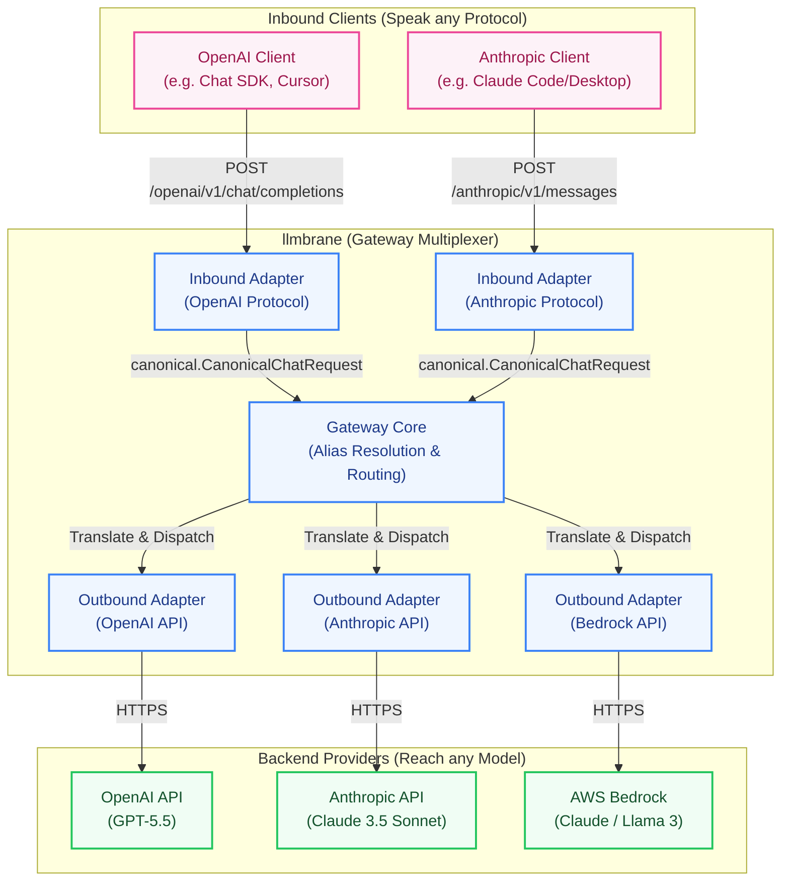

# llmbrane

`llmbrane` is a lightweight gateway for routing LLM requests across multiple providers through a single, configurable interface.



Today, `llmbrane` exposes OpenAI-compatible and Anthropic-compatible inbound APIs. Clients can send normal OpenAI-style or Anthropic-style requests to the gateway, while `llmbrane` resolves model aliases, selects the configured backend provider, translates the request into that provider's API shape, and translates the response back for the client.

The architecture is designed to support multiple inbound APIs over time. That means clients can speak different familiar API formats, such as OpenAI, Anthropic, or other protocol shapes, while still reaching any configured outbound provider behind the gateway.

Use it when you want to:

- switch models or providers without changing client code
- expose one stable API to tools that only understand OpenAI-style requests
- route requests to cloud, local, or self-hosted models from configuration
- keep provider credentials and model mappings centralized
- add new providers or inbound API formats behind a consistent gateway architecture

## Getting Started

### 1. Create your Configuration

`llmbrane` uses a simple configuration file and environment variables for secrets. You can deploy and run it with just two files.

First, create a `config.yaml`:

```yaml
# yaml-language-server: $schema=https://raw.githubusercontent.com/mayer-tech/llmbrane/main/config.schema.json
version: 1
server:
  listen: ":8080"
  request_timeout: 120s

aliases:
  gpt-latest: openai/gpt-5.6-sol
  claude-sonnet: anthropic/claude-sonnet-4-6

providers:
  openai:
    endpoints:
      - api: "openai-responses"
        url: "https://api.openai.com/v1/responses"
        headers:
          Authorization: "Bearer ${OPENAI_API_KEY}"
        # Optional: enables a local in-memory TPM queue for this endpoint.
        rate_limit:
          tokens_per_minute: 200000
          utilization: 0.9
          queue_timeout: 30s
          # Internal reservation only; not sent to the model.
          output_reservation_tokens: 8192
        extensions:
          omit_params: ["temperature", "top_p"]
        models:
          gpt-5.6-sol:
            target: gpt-5.6-sol
          gpt-5.6-terra:
            target: gpt-5.6-terra
          gpt-5.6-luna:
            target: gpt-5.6-luna

  anthropic:
    endpoints:
      - api: "anthropic-messages"
        url: "https://api.anthropic.com/v1/messages"
        headers:
          x-api-key: "${ANTHROPIC_API_KEY}"
        models:
          claude-opus-4-8:
            target: claude-opus-4-8
            default_reasoning_effort: medium
          claude-sonnet-4-6:
            target: claude-sonnet-4-6

  gemini:
    endpoints:
      - api: "openai-chat-completions"
        url: "https://generativelanguage.googleapis.com/v1beta/openai/chat/completions"
        headers:
          Authorization: "Bearer ${GEMINI_API_KEY}"
        extensions:
          inject_thought_signature_bypass: true
          reasoning_effort_mapping:
            none: "low"
            minimal: "low"
            xhigh: "high"
            max: "high"
        models:
          gemini-pro-latest:
            target: gemini-pro-latest
          gemini-flash-latest:
            target: gemini-flash-latest
          gemini-flash-lite-latest:
            target: gemini-flash-lite-latest
```

Next, create a `.env` file containing your API keys:

```env
OPENAI_API_KEY=your-openai-api-key-here
ANTHROPIC_API_KEY=your-anthropic-api-key-here
```

*(For a more comprehensive example configuration including AWS Bedrock or Google Gemini, see the [config.example.yaml](config.example.yaml) in the repository.)*

### 2. Run the Container

Start the gateway using Docker Compose. Create a `docker-compose.yml` file pointing to the official `llmbrane` image:

```yaml
services:
  llmbrane:
    image: ghcr.io/mayer-tech/llmbrane:latest
    ports:
      - "8080:8080"
    volumes:
      - ./config.yaml:/config/config.yaml:ro
    env_file:
      - .env
    restart: unless-stopped
```

Then run:

```bash
docker compose up -d
```

### 3. Example Requests

Since `llmbrane` provides an OpenAI-compatible and Anthropic-compatible inbound handler, you can interact with it using standard API structures. Use either model aliases from `config.yaml` or explicit names in the `provider/model` format.

**Requesting via OpenAI API shape (using the alias `gpt-latest`):**
```bash
curl http://localhost:8080/openai/v1/chat/completions \
  -H "Content-Type: application/json" \
  -d '{
    "model": "gpt-latest",
    "messages": [{"role": "user", "content": "Hello, how are you?"}]
  }'
```

**Requesting via Anthropic API shape (using the alias `claude-sonnet`):**
```bash
curl http://localhost:8080/anthropic/v1/messages \
  -H "Content-Type: application/json" \
  -H "x-api-key: none" \
  -d '{
    "model": "claude-sonnet",
    "max_tokens": 1024,
    "messages": [{"role": "user", "content": "Hello, Claude!"}]
  }'
```

## Configuration

`config.yaml` defines how the gateway listens, how incoming model names are resolved, and which provider APIs are called.

- `server.listen` controls the bind address. The example uses `:8080`.
- `server.request_timeout` sets the request timeout value stored in configuration.
- `retry` (optional) configures provider-side HTTP 429 retries: `max_retries` (default `6`, `0` disables retries), `base_delay` (default `1s`), `jitter` (default `250ms`), and `max_delay` (default `60s`). See [Rate-Limit Handling](#rate-limit-handling).
- `aliases` maps convenient client-facing model names to explicit `provider/model` targets. For example, `gpt-latest: openai/gpt-5.5` lets clients send `"model": "gpt-latest"`. An alias can also be a mapping with a `target` and an optional `default_reasoning_effort` override (see [Reasoning Effort Support](#reasoning-effort-support)).
- `providers` contains named backend providers. The provider name becomes the first part of an explicit model reference, such as `anthropic/claude-sonnet-4-6`.
- `providers.<name>.endpoints[].api` selects the outbound adapter/API shape.
- `providers.<name>.endpoints[].url` is the provider endpoint. Bedrock URLs can include `{target_model}`, which is replaced with the configured target model.
- `providers.<name>.endpoints[].headers` configures provider-specific HTTP headers. Values like `${OPENAI_API_KEY}` are read from the process environment.
- `providers.<name>.endpoints[].models` maps llmbrane model names to provider-native `target` model IDs.
- `providers.<name>.endpoints[].models.<name>.default_reasoning_effort` sets a canonical reasoning effort (`none`, `minimal`, `low`, `medium`, `high`, `xhigh`, `max`) applied when the client omits `reasoning_effort`. See [Reasoning Effort Support](#reasoning-effort-support).
- `providers.<name>.endpoints[].extensions` enables adapter-specific behavior.

Local secrets are intentionally kept out of the repository and Docker build context. The examples contain placeholders only; real credentials belong in your untracked `.env` file or in the process environment.

### JSON Schema & Editor Support

The repository ships a JSON Schema for `config.yaml`: [config.schema.json](https://github.com/mayer-tech/llmbrane/blob/main/config.schema.json) ([raw](https://raw.githubusercontent.com/mayer-tech/llmbrane/main/config.schema.json)). It validates the full configuration structure, including the `api` enum, capability names, `rate_limit` ranges, and adapter-specific `extensions` keys.

Add the schema reference as the first line of your `config.yaml` to get validation, autocompletion, and hover documentation in editors that support the YAML language server (VS Code with the [YAML extension](https://marketplace.visualstudio.com/items?itemName=redhat.vscode-yaml), Neovim, etc.):

```yaml
# yaml-language-server: $schema=https://raw.githubusercontent.com/mayer-tech/llmbrane/main/config.schema.json
version: 1
```

Alternatively, map the schema once in your editor settings instead of the comment, e.g. in VS Code's `settings.json`:

```json
{
  "yaml.schemas": {
    "https://raw.githubusercontent.com/mayer-tech/llmbrane/main/config.schema.json": "config.yaml"
  }
}
```

When working inside a clone of this repository, a relative reference also works: `# yaml-language-server: $schema=./config.schema.json`.

### Available Outbound Adapters

`llmbrane` currently supports the following outbound API shapes, configured via the `api` field in an endpoint:

- **`openai-chat-completions`**: Standard OpenAI API (`/v1/chat/completions`). Used for OpenAI and OpenAI-compatible endpoints like local servers or Google Gemini's OpenAI compatibility mode.
  - **Configuration**: Requires standard OpenAI headers, such as `Authorization: Bearer ...`.
  - **Extensions**: 
    - `inject_thought_signature_bypass` (boolean): Injects a `skip_thought_signature_validator` bypass for tool calls.
    - `reasoning_effort_mapping` (map): Custom mapping table for `reasoning_effort` values (e.g. mapping `xhigh` or `max` to `high` for models that only accept `low`, `medium`, `high`).
- **`openai-responses`**: OpenAI Responses API (`/v1/responses`). Supports text, image, tool calls, reasoning summaries, and structured output (`json_schema`, `json_object`).
  - **Configuration**: Requires standard OpenAI headers, such as `Authorization: Bearer ...`.
  - **Extensions**:
    - `reasoning_effort_mapping` (map): Custom mapping table for `reasoning_effort` values.
    - `omit_params` (list of strings): Parameters that must not be sent to the provider (e.g. `temperature`, `top_p` for reasoning models that reject them).
- **`anthropic-messages`**: Anthropic's Messages API.
  - **Configuration**: Requires Anthropic-specific headers, such as `x-api-key`. By default, active reasoning levels use adaptive thinking and `output_config.effort`; `none` requests disabled thinking.
  - **Extensions**:
    - `thinking_mode`: `adaptive` (default) or `budget` for older models that require manual thinking budgets.
    - `reasoning_effort_mapping`: Maps canonical levels to other canonical levels before translation, for example `xhigh: high` or `none: low`. Use separate endpoints when models need different settings.
- **`bedrock-converse`**: AWS Bedrock Converse API.
  - **Configuration**: Requires AWS credentials through `extensions` for direct Bedrock calls, or normal HTTP headers when targeting a Bedrock-compatible proxy. Translates canonical `reasoning_effort` into Bedrock Converse thinking parameters under `additionalModelRequestFields`.

### Reasoning Effort Support

`llmbrane` standardizes reasoning effort control across providers into a unified canonical scale:
`none`, `minimal`, `low`, `medium`, `high`, `xhigh`, `max`.

- **OpenAI Inbound**: Accepts `reasoning_effort` strings and passes canonical values through.
- **Anthropic Inbound**: Reads `output_config.effort` (`low`, `medium`, `high`, `xhigh`, `max`) directly. `thinking.type: disabled` maps to `none`. Adaptive thinking without an explicit effort leaves it unset, so alias or model defaults may still apply. For legacy `thinking.type: enabled`, the budget is mapped to a canonical level; the exact budget is lost:
  - `0` / `disabled` $\rightarrow$ `none`
  - `1..1024` $\rightarrow$ `minimal`
  - `1025..2048` $\rightarrow$ `low`
  - `2049..4096` $\rightarrow$ `medium`
  - `4097..8192` $\rightarrow$ `high`
  - `8193..16384` $\rightarrow$ `xhigh`
  - `> 16384` $\rightarrow$ `max`

  The canonical model cannot represent an independent thinking mode and effort. Requests combining `enabled` or `disabled` thinking with an explicit effort, or combining a budget with a different thinking mode, are rejected with HTTP 400.
- **OpenAI Outbound**: Uses canonical `reasoning_effort` values or maps them according to endpoint `reasoning_effort_mapping` extension if configured.
- **Anthropic Outbound**: By default, `none` sends `thinking.type: disabled`; other levels send `thinking.type: adaptive` and `output_config.effort`. `minimal` maps to `low`, while `low`, `medium`, `high`, `xhigh` and `max` pass through. If effort is unset, neither field is sent.
- **Bedrock Outbound**: Translates canonical effort levels to token budgets for AWS Bedrock Converse, as before.

Anthropic endpoint extensions can override the canonical effort before translation or select the legacy budget mode:

```yaml
extensions:
  thinking_mode: budget # optional; default is adaptive
  reasoning_effort_mapping:
    xhigh: high
    # none: low # optional approximation: enables thinking instead of disabling it
```

The mapping applies to every model on the endpoint, including in budget mode. Use separate endpoints for models requiring different modes or mappings. This changes the previous default: older models that require manual budgets must explicitly use `thinking_mode: budget`. Adaptive effort controls the entire response and is not equivalent to a fixed thinking-token budget. Supported effort levels and the ability to disable thinking vary by model; llmbrane does not detect these capabilities, and the provider may reject unsupported combinations. An inbound effort without a thinking mode is also translated to adaptive thinking on Anthropic outbound, so the original mode is not preserved.

This configuration controls requests only: Anthropic thinking blocks and signatures are not currently preserved through responses, streams, or conversation history. In particular, thinking-enabled tool-use conversations that require those blocks may fail. See Anthropic's [effort](https://platform.claude.com/docs/en/build-with-claude/effort) and [extended thinking](https://platform.claude.com/docs/en/build-with-claude/extended-thinking) documentation for model-specific restrictions.

#### Per-Model Defaults

If a request does not carry a reasoning effort, no reasoning configuration is sent upstream and each provider falls back to its own (often model-specific) default. To make this deterministic, set `default_reasoning_effort` on a model:

```yaml
models:
  claude-opus-4-8:
    target: claude-opus-4-8
    default_reasoning_effort: medium
```

Precedence rules:

1. An explicit client effort or disabled thinking (mapped to `"none"`) takes precedence over the alias/model defaults; the endpoint mapping can still override it.
2. Otherwise, the alias's `default_reasoning_effort` (if the request used an alias that defines one) is injected.
3. Otherwise, the resolved model's `default_reasoning_effort` is injected as the canonical effort level.
4. If none is set, nothing is sent and the provider default applies.

An alias can override the default of its target model:

```yaml
aliases:
  claude-sonnet:
    target: anthropic/claude-sonnet-4-6
    default_reasoning_effort: high
```

The injected value is a canonical level and is processed like any client-supplied value afterwards — endpoint `reasoning_effort_mapping` tables still apply. Aliases without their own default inherit the default of their target model. Invalid values are rejected at startup. The effective canonical effort also feeds the local TPM queue's output reservation; this is only an estimate, not an actual budget for adaptive thinking.

### Rate-Limit Handling

All outbound adapters transparently retry initial HTTP `429 Too Many Requests` responses. By default a request is retried up to six times. LLMbrane honors `Retry-After` and common provider rate-limit reset headers; without such a header it uses exponential backoff starting at 1 s (1 s, 2 s, 4 s, 8 s, 16 s, 32 s) plus a random jitter of up to 250 ms. Retries never happen after a successful streaming response has started. Delays above 60 seconds or beyond the request deadline are not retried; the provider's `429` response and normalized `Retry-After` header are returned to the client instead.

Retry behavior is configurable via the optional `retry` block in `config.yaml` (see [Configuration](#configuration)).

#### Optional Local TPM Queue

The local queue is disabled by default. It activates per endpoint only when `rate_limit.tokens_per_minute` is configured or a provider response contains a supported `*-ratelimit-*-limit-*-tokens` header. It never changes `reasoning_effort`, `max_tokens`, or the provider request.

For each request, LLMbrane reserves an estimated input and output budget in a rolling 60-second window. The output reservation is, in order: the client's explicit output limit, `output_reservation_tokens`, a learned P95 of completed requests, or the canonical reasoning budget (minimum 4096 tokens). The latter is internal accounting only.

For requests carrying `X-Interaction-Id` (GitHub Copilot) or `X-Conversation-Id`, a verified unchanged conversation prefix uses the preceding actual input usage plus only the estimated new messages. All reservations are reconciled with provider usage after completion. Runtime logs report inactive budgets, learned limits, reservations, waits, and final usage.

### Debug File Logging

Set `logging.debug_dir` to enable debug files. `logging.debug_retention` controls how long files are retained based on their last modification time (default: `24h`). Runtime messages remain in `runtime.log`.

Traffic is stored in three separate files per conversation, with the timestamp of its first request and the ID before the direction so related files sort together:

- `2026-10-18T16:30:21Z_<id>_inbound.jsonl`
- `2026-10-18T16:30:21Z_<id>_canonical.jsonl`
- `2026-10-18T16:30:21Z_<id>_outbound.jsonl`

`X-Conversation-Id` takes precedence over `X-Interaction-Id`. Requests with the same ID append to the same files, including across days and gateway restarts while matching files remain on disk. If the client changes its interaction ID on every turn, grouping is per interaction rather than per full conversation. Without either header, each inbound request gets a cryptographically random unique ID and its own file group, even if multiple requests start in the same second. These generated IDs are local to logging and are not sent to providers.

All three layers share a `request_id` in each entry to correlate individual calls within a conversation, including streaming and outbound retries. When supplied, the original client ID is recorded as `conversation_id`. Common filename-safe IDs are preserved; unsafe or overly long IDs are represented by a SHA-256 hash in filenames. Files are created only for layers reached by a request. Existing daily logs are not migrated and remain subject to the same retention policy.

The `.jsonl` extension retains the existing debug format: pretty-printed JSON blocks separated by comment headers, not strict single-line JSONL. Debug files contain full request and response content; protect access to the log directory. Splitting logs improves navigation but does not reduce total log volume.

## For Developers

The codebase is organized into several distinct areas to cleanly separate concerns between protocol parsing, gateway routing, and provider-specific mapping.

### Architecture Overview

- **`cmd/llmbrane`**: The application entrypoint. It loads the config, initializes the `Gateway`, registers outbound adapters, attaches inbound handlers to the HTTP router, and starts the server.
- **`internal/canonical`**: Defines the internal, unified data models for requests and responses (e.g., `CanonicalChatRequest`). All incoming requests are converted to these models before being passed to the outbound adapters.
- **`internal/config`**: Configuration parsing. Holds structures like `Provider`, `Endpoint`, and `Model`.
- **`internal/core`**: The heart of `llmbrane`. The `Gateway` resolves models, applies aliases, and matches requests to the correct registered `OutboundAdapter`.
- **`internal/inbound`**: Handlers that receive incoming HTTP requests. For example, `inbound/openai` parses OpenAI-formatted JSON bodies, translates them into the `canonical` format, and invokes the `Gateway`.
- **`internal/outbound`**: Adapters that take `canonical` models and translate them into provider-specific API calls. E.g., `outbound/anthropic` converts `CanonicalChatRequest` into an Anthropic Messages API payload.

### How Routing Works

1. **Inbound Request**: An HTTP request arrives at an inbound handler (e.g., `POST /openai/v1/chat/completions`). The handler parses the JSON and looks at the requested `model` string (e.g., `"gpt-latest"`).
2. **Gateway Resolution**: The handler passes the canonical request to `Gateway`. The Gateway looks up the model:
   - It checks for an **alias** (e.g., `"gpt-latest" -> "openai/gpt-5.5"`).
   - It splits the target into **Provider** (`"openai"`) and **Model** (`"gpt-5.5"`).
   - It checks the configuration to find the matching provider and endpoint for this model.
3. **Outbound Dispatching**: The config defines an `api` type (API shape) for the endpoint (e.g., `api: "anthropic-messages"`). The `Gateway` looks up the `OutboundAdapter` registered for this API shape.
4. **Translation & Execution**: The `OutboundAdapter` translates the canonical request to the provider's specific API format, sends the HTTP request, translates the response back to canonical format, and returns it to the inbound handler.

### Developing Adapters

#### Creating a New Outbound Adapter

To add a new provider (e.g., Ollama):
1. Create a package in `internal/outbound/ollama`.
2. Implement the `core.OutboundAdapter` interface (`ProcessChat`, `ProcessChatStream`).
3. These methods receive a `canonical.CanonicalChatRequest`. Map this to the provider-specific payload and make the network call.
4. Convert the provider's response into a `canonical.CanonicalChatResponse`.
5. In `cmd/llmbrane/main.go`, register the adapter with the Gateway:
   ```go
   gateway.RegisterOutboundAdapter("ollama", outbound_ollama.NewAdapter())
   ```
6. Users can now define endpoints with `api: "ollama"` in their `config.yaml`.

#### Adding an Inbound Handler

To add a new API interface (e.g., an Anthropic-compatible API for incoming requests):
1. Create a package in `internal/inbound/anthropic`.
2. Implement an HTTP handler that decodes Anthropic requests.
3. Map the decoded request to `canonical.CanonicalChatRequest`.
4. Call the Gateway to process it.
5. Map the returned `canonical.CanonicalChatResponse` back to the expected Anthropic JSON structure and write the HTTP response.
6. Register the handler to the `router` in `cmd/llmbrane/main.go`.
